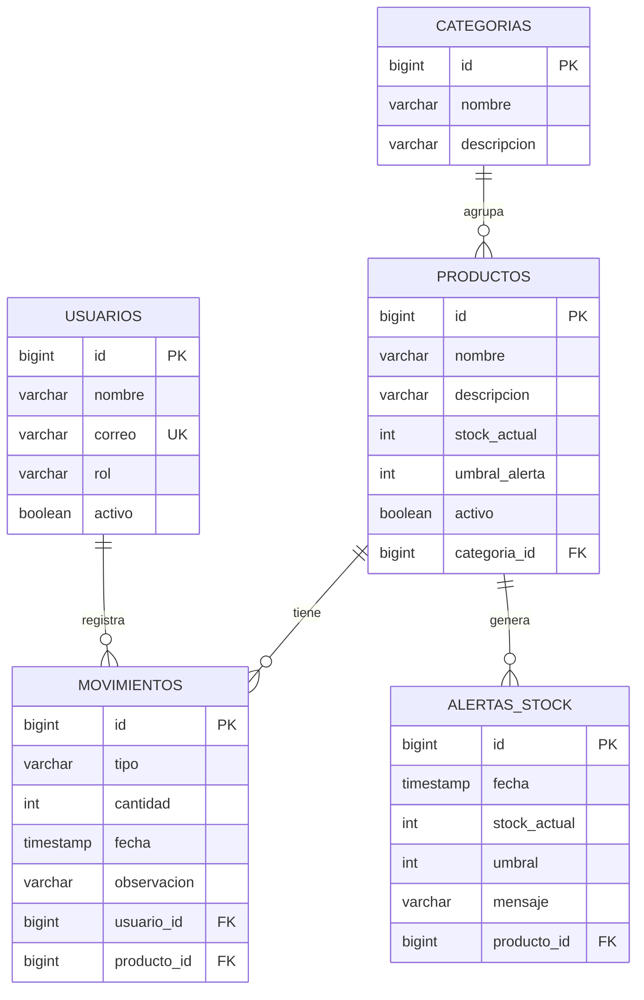

# Inventario y movimientos para microempresa

API REST (backend) para administrar productos, categorías, usuarios y movimientos de inventario de una microempresa. Calcula las existencias, rechaza operaciones inválidas, conserva trazabilidad de cada movimiento y genera alertas cuando el stock queda por debajo de un umbral.

**Autores:** Narváez Montoya Jerónimo · Muñoz Cataño Daniel José

---

## Tabla de contenido

1. [Contexto y problema](#1-contexto-y-problema)
2. [Usuarios del sistema](#2-usuarios-del-sistema)
3. [Tecnologías](#3-tecnologías)
4. [Arquitectura](#4-arquitectura)
5. [Modelo de datos](#5-modelo-de-datos)
6. [Reglas de negocio y dónde se cumple cada una](#6-reglas-de-negocio-y-dónde-se-cumple-cada-una)
7. [Contrato HTTP](#7-contrato-http)
8. [Formato de errores](#8-formato-de-errores)
9. [Cómo funciona el registro de un movimiento](#9-cómo-funciona-el-registro-de-un-movimiento)
10. [Decisiones de diseño y principios SOLID](#10-decisiones-de-diseño-y-principios-solid)
11. [Cómo ejecutar el proyecto](#11-cómo-ejecutar-el-proyecto)
12. [Cómo probar el proyecto](#12-cómo-probar-el-proyecto)
13. [Limitaciones conocidas y mejoras futuras](#13-limitaciones-conocidas-y-mejoras-futuras)
14. [Glosario](#14-glosario)

---

## 1. Contexto y problema

Una microempresa registra sus entradas y salidas de mercancía en hojas manuales. Esto produce tres problemas:

- Diferencias entre las existencias reales y las registradas.
- Stock negativo (se "vende" más de lo que hay).
- Poca claridad sobre quién realizó cada movimiento.

El proyecto demuestra que un backend **no es solamente un CRUD** (crear, leer, actualizar y borrar datos). La aplicación toma decisiones a partir de reglas del dominio, rechaza operaciones inválidas, conserva trazabilidad y responde mediante contratos HTTP consistentes.

**Problema que resuelve:** administrar productos y movimientos, calcular existencias y generar alertas cuando el stock esté por debajo de un umbral.

## 2. Usuarios del sistema

| Rol | Responsabilidad según el enunciado | Cómo se refleja en el código |
|---|---|---|
| `ADMINISTRADOR` | Configura productos, categorías y umbrales. | Existe como rol. Un administrador **no puede** registrar movimientos (el sistema responde 403). |
| `AUXILIAR_BODEGA` | Registra entradas y salidas. | Es el único rol autorizado para `POST /api/movimientos`. |

> Nota: no hay autenticación (inicio de sesión). El usuario que realiza un movimiento se identifica con el campo `usuarioId` del cuerpo de la petición. Ver [limitaciones](#13-limitaciones-conocidas-y-mejoras-futuras).

## 3. Tecnologías

| Tecnología | Versión | Para qué se usa |
|---|---|---|
| Java | 25 | Lenguaje de programación. |
| Spring Boot | 4.1.1 | Framework que arma la aplicación web y la configura automáticamente. |
| Spring Web MVC | (incluido en Spring Boot) | Define los endpoints REST mediante controladores. |
| Spring Data JPA / Hibernate | (incluido en Spring Boot) | Mapea las clases Java a tablas (ORM) y genera las consultas SQL. |
| PostgreSQL | — | Base de datos relacional. |
| Lombok | 1.18.46 | Genera código repetitivo (getters, setters, constructores) mediante anotaciones. |
| Maven | — | Gestión de dependencias y construcción del proyecto. |

## 4. Arquitectura

El proyecto usa una **arquitectura por capas**. Cada capa tiene una única responsabilidad y solo habla con la capa inmediatamente inferior:

```
Cliente HTTP (Postman, navegador, otra aplicación)
        │  JSON
        ▼
┌─────────────────┐
│   Controller    │  Recibe la petición HTTP y devuelve la respuesta. No contiene reglas.
└────────┬────────┘
         ▼
┌─────────────────┐
│     Service     │  Contiene las reglas de negocio y las transacciones.
└────────┬────────┘
         ▼
┌─────────────────┐
│   Repository    │  Acceso a la base de datos (interfaces de Spring Data JPA).
└────────┬────────┘
         ▼
┌─────────────────┐
│     Entity      │  Clases que representan las tablas.
└────────┬────────┘
         ▼
     PostgreSQL
```

Los datos que entran y salen de la API no son las entidades directamente, sino **DTO** (*Data Transfer Object*), implementados como `record` de Java. Así la API no expone la estructura interna de la base de datos.

### Estructura de paquetes

Paquete base: `co.edu.autonoma.inventarioapi`

```
src/main/java/co/edu/autonoma/inventarioapi
├── controller
│   ├── AlertaController.java        GET  /api/alertas
│   ├── CategoriaController.java     CRUD /api/categorias
│   ├── EstadoController.java        GET  /api/estado
│   ├── MovimientoController.java    /api/movimientos
│   ├── ProductoController.java      /api/productos
│   └── UsuarioController.java       /api/usuarios
├── service
│   ├── AlertaService.java           Regla de alertas de stock
│   ├── CategoriaService.java        Reglas de categorías (incluye el DELETE)
│   ├── EstadoService.java
│   ├── MovimientoService.java       Registro de movimientos y cálculo del stock
│   ├── ProductoService.java         Reglas de productos
│   └── UsuarioService.java          Reglas de usuarios
├── repository
│   ├── AlertaRepository.java
│   ├── CategoriaRepository.java
│   ├── MovimientoRepository.java
│   ├── ProductoRepository.java      Incluye la consulta con bloqueo (concurrencia)
│   └── UsuarioRepository.java
├── entity
│   ├── AlertaStockEntity.java
│   ├── CategoriaEntity.java
│   ├── MovimientoEntity.java
│   ├── ProductoEntity.java
│   ├── UsuarioEntity.java
│   ├── Rol.java                     enum: ADMINISTRADOR, AUXILIAR_BODEGA
│   └── TipoMovimiento.java          enum: ENTRADA, SALIDA
├── dto                              Objetos de entrada y salida de la API (records)
└── exception
    └── GlobalExceptionHandler.java  Respuesta uniforme para todos los errores
```

## 5. Modelo de datos



| Entidad | Tabla | Descripción |
|---|---|---|
| `CategoriaEntity` | `categorias` | Agrupa productos. Su nombre no se puede repetir (sin distinguir mayúsculas). |
| `ProductoEntity` | `productos` | Guarda la **existencia actual** (`stockActual`), el umbral de alerta y si está activo. Nace con stock 0. |
| `UsuarioEntity` | `usuarios` | Persona que opera el sistema. El correo es único. |
| `MovimientoEntity` | `movimientos` | Cada entrada o salida. Es el **historial (kardex)** y no se modifica ni se borra. |
| `AlertaStockEntity` | `alertas_stock` | Registro generado cuando una salida deja el stock por debajo del umbral. |

La base de datos se crea y se ajusta automáticamente con `spring.jpa.hibernate.ddl-auto=update`.

## 6. Reglas de negocio y dónde se cumple cada una

| Regla | Descripción | Dónde se cumple |
|---|---|---|
| **RN-01** | Ninguna salida puede dejar el stock en negativo. | `MovimientoService.calcularNuevoStock`: si `cantidad > stockActual` responde 409. Además, `ProductoRepository.buscarParaActualizar` bloquea el producto durante la operación para que dos salidas simultáneas no puedan romper la regla. |
| **RN-02** | Todo movimiento tiene tipo `ENTRADA` o `SALIDA` y cantidad positiva. | `MovimientoService.validarRequest` (cantidad mayor que 0, tipo obligatorio). El tipo está limitado por el enum `TipoMovimiento`: cualquier otro valor se rechaza con 400. |
| **RN-03** | La existencia se actualiza de forma consistente con cada movimiento. | `MovimientoService.registrarMovimiento` está anotado con `@Transactional`: el nuevo stock, el movimiento y la alerta se guardan juntos o no se guarda nada. El stock **no** se puede fijar al crear un producto (nace en 0) ni editar por la API: solo cambia mediante movimientos. |
| **RN-04** | El umbral de alerta debe ser cero o positivo. | `ProductoService.validarDatosProducto`, usado al crear (`POST`) y al reemplazar (`PUT`) un producto. Responde 400 si es negativo. |
| **RN-05** | No se elimina un producto con movimientos; se inactiva. | La API **no ofrece** ningún `DELETE` de productos (responde 405). Se usa `PATCH /api/productos/{id}/estado`. Además, un producto inactivo no admite movimientos (409). |
| **RN-06** | Cada movimiento conserva fecha, usuario y observación. | `MovimientoEntity`: la fecha se asigna automáticamente con `@PrePersist`; el usuario es obligatorio (`optional = false`) y se valida que exista, esté activo y sea auxiliar de bodega; la observación se guarda tal cual. |

Reglas adicionales que implementa el sistema:

- **Alertas de stock:** después de una salida, si `stock < umbral` se guarda una alerta. Si el stock es **igual** al umbral no hay alerta (el enunciado dice "por debajo").
- **Roles:** solo un usuario `AUXILIAR_BODEGA` y activo puede registrar movimientos.
- **Eliminación de categorías:** solo si no tienen productos asociados (incluso productos inactivos).
- **Unicidad:** no se repiten nombres de categoría ni correos de usuario.

## 7. Contrato HTTP

URL base: `http://localhost:8080`. Todas las peticiones y respuestas usan JSON.

### 7.1 Contrato mínimo exigido por el enunciado

| Verbo | Ruta | Responsabilidad | Respuestas |
|---|---|---|---|
| GET | `/api/productos` | Lista productos y existencias. | 200 |
| GET | `/api/movimientos?productoId=` | Consulta el kardex de un producto. | 200, 400, 404 |
| POST | `/api/movimientos` | Registra entrada o salida. | 201, 400, 403, 404, 409 |
| PUT | `/api/productos/{id}` | Reemplaza la ficha de un producto. | 200, 400, 404 |
| PATCH | `/api/productos/{id}/estado` | Activa o inactiva un producto. | 200, 400, 404 |
| DELETE | `/api/categorias/{id}` | Elimina una categoría sin productos asociados. | 204, 404, 409 |

### 7.2 Endpoints adicionales (necesarios para manejar el CRUD)

El enunciado indica que, si hace falta algo más para el manejo del CRUD, se debe sumar a la lista. Sin estos endpoints el administrador no podría crear las categorías, productos ni usuarios que el resto del sistema necesita.

| Verbo | Ruta | Responsabilidad | Respuestas |
|---|---|---|---|
| POST | `/api/productos` | Crea un producto (stock inicial 0). | 201, 400, 404 |
| GET | `/api/productos/{id}` | Consulta un producto. | 200, 404 |
| GET | `/api/categorias` | Lista categorías. | 200 |
| GET | `/api/categorias/{id}` | Consulta una categoría. | 200, 404 |
| POST | `/api/categorias` | Crea una categoría. | 201, 400, 409 |
| PUT | `/api/categorias/{id}` | Actualiza una categoría. | 200, 400, 404, 409 |
| GET | `/api/usuarios` | Lista usuarios. | 200 |
| GET | `/api/usuarios/{id}` | Consulta un usuario. | 200, 404 |
| POST | `/api/usuarios` | Crea un usuario. | 201, 400, 409 |
| GET | `/api/alertas` | Lista las alertas de stock (más recientes primero). Filtro opcional `?productoId=`. | 200, 404 |
| GET | `/api/estado` | Verifica que el servicio está disponible. | 200 |

### 7.3 Significado de los códigos HTTP usados

| Código | Significado en este proyecto |
|---|---|
| 200 OK | Consulta o actualización exitosa. |
| 201 Created | Recurso creado. |
| 204 No Content | Eliminación exitosa (sin cuerpo en la respuesta). |
| 400 Bad Request | Datos inválidos o faltantes (cantidad no positiva, umbral negativo, JSON mal formado, etc.). |
| 403 Forbidden | El usuario existe pero su rol no permite la operación (un administrador intentando registrar un movimiento). |
| 404 Not Found | El recurso no existe. |
| 405 Method Not Allowed | La ruta no admite ese verbo (por ejemplo, borrar un producto). |
| 409 Conflict | La operación choca con el estado actual: stock insuficiente, producto o usuario inactivo, nombre o correo duplicado, categoría con productos. |

### 7.4 Ejemplos

**Crear un producto** — `POST /api/productos`

```json
{
  "nombre": "Gaseosa 400ml",
  "descripcion": "Botella plástica",
  "umbralAlerta": 10,
  "categoriaId": 1
}
```

Respuesta `201 Created`:

```json
{
  "id": 1,
  "nombre": "Gaseosa 400ml",
  "descripcion": "Botella plástica",
  "stockActual": 0,
  "umbralAlerta": 10,
  "activo": true,
  "categoriaId": 1,
  "categoriaNombre": "Bebidas"
}
```

**Registrar un movimiento** — `POST /api/movimientos`

```json
{
  "tipo": "SALIDA",
  "cantidad": 15,
  "usuarioId": 2,
  "observacion": "Venta del día",
  "productoId": 1
}
```

Respuesta `201 Created`:

```json
{
  "id": 7,
  "tipo": "SALIDA",
  "cantidad": 15,
  "fecha": "2026-11-12T17:42:10.123456",
  "usuarioId": 2,
  "usuarioNombre": "Luis Bodega",
  "observacion": "Venta del día",
  "productoId": 1,
  "productoNombre": "Gaseosa 400ml"
}
```

**Consultar alertas** — `GET /api/alertas?productoId=1`

```json
[
  {
    "id": 1,
    "fecha": "2026-11-12T17:42:10.130000",
    "productoId": 1,
    "productoNombre": "Gaseosa 400ml",
    "stockActual": 5,
    "umbral": 10,
    "mensaje": "El producto 'Gaseosa 400ml' tiene stock 5, por debajo del umbral 10"
  }
]
```

**Inactivar un producto** — `PATCH /api/productos/1/estado`

```json
{ "activo": false }
```

**Crear un usuario** — `POST /api/usuarios` (el rol es `ADMINISTRADOR` o `AUXILIAR_BODEGA`)

```json
{
  "nombre": "Luis Bodega",
  "correo": "luis@mail.com",
  "rol": "AUXILIAR_BODEGA"
}
```

## 8. Formato de errores

Todos los errores de la API se devuelven con la misma estructura, gracias al `GlobalExceptionHandler` (una clase anotada con `@RestControllerAdvice` que intercepta las excepciones de cualquier controlador). Esto cumple el requisito de "contratos HTTP consistentes": quien consuma la API siempre sabe cómo leer un error.

```json
{
  "timestamp": "2026-11-12T17:45:03.512",
  "status": 409,
  "error": "Conflict",
  "mensaje": "Stock insuficiente para registrar la salida",
  "ruta": "/api/movimientos"
}
```

Casos cubiertos: errores de negocio lanzados desde los servicios, JSON mal formado, valores de enum inválidos (por ejemplo, un tipo de movimiento distinto de `ENTRADA` o `SALIDA`), parámetros obligatorios faltantes y parámetros con un tipo incorrecto.

## 9. Cómo funciona el registro de un movimiento

`POST /api/movimientos` es el flujo central del sistema. Todo ocurre dentro de **una sola transacción**: si algún paso falla, no se guarda nada.

1. **Validar la petición:** tipo, cantidad positiva, producto y usuario presentes (si no, 400).
2. **Buscar y bloquear el producto** con `buscarParaActualizar` (404 si no existe). El bloqueo evita que otra petición modifique el mismo producto al mismo tiempo.
3. **Buscar el usuario** (404 si no existe).
4. **Validar el usuario:** debe estar activo (409) y ser `AUXILIAR_BODEGA` (403).
5. **Validar el producto:** debe estar activo (409).
6. **Calcular el nuevo stock:** una `ENTRADA` suma; una `SALIDA` resta y se rechaza con 409 si la cantidad supera el stock (RN-01).
7. **Guardar** el nuevo stock del producto y el movimiento (con fecha, usuario y observación).
8. **Si fue una `SALIDA`:** `AlertaService.evaluarStock` crea una alerta cuando el stock quedó por debajo del umbral.
9. **Responder** con el movimiento registrado (201).

### Por qué se bloquea el producto (concurrencia)

Sin bloqueo, dos salidas simultáneas de 8 unidades sobre un producto con stock 10 podrían leer ambas "10", pasar la validación y dejar registradas 16 unidades de salida con solo 10 en bodega. Con el bloqueo pesimista (`@Lock(LockModeType.PESSIMISTIC_WRITE)`, equivalente a `SELECT ... FOR UPDATE` en SQL), la segunda petición espera a que termine la primera y lee el stock ya actualizado (2), por lo que es rechazada con 409. Los productos distintos no se bloquean entre sí.

## 10. Decisiones de diseño y principios SOLID

| Principio | Cómo se aplica en el proyecto |
|---|---|
| **S** — Responsabilidad única | Cada clase hace una sola cosa: los controladores solo reciben y responden, los servicios contienen las reglas, los repositorios acceden a datos. `AlertaService` es el único que sabe cuándo debe haber una alerta; `GlobalExceptionHandler` es el único que da formato a los errores. |
| **O** — Abierto/cerrado | Para cambiar la regla de alertas basta modificar `AlertaService`; `MovimientoService` no se toca. Para sumar un nuevo tipo de error con formato uniforme, se agrega un método al `GlobalExceptionHandler` sin cambiar los servicios. |
| **L** — Sustitución de Liskov | Los servicios dependen de las interfaces `JpaRepository`, de modo que cualquier implementación (la real o una simulada) se puede usar en su lugar sin alterar el comportamiento. |
| **I** — Segregación de interfaces | Hay un repositorio pequeño por entidad, con solo los métodos que esa entidad necesita. |
| **D** — Inversión de dependencias | Los servicios no crean sus dependencias: las reciben por constructor (inyección de dependencias de Spring), usando `@RequiredArgsConstructor` de Lombok. |

Otras decisiones:

- **DTO como `record`:** son inmutables y concisos, y separan el contrato público de la estructura interna de las entidades.
- **Lombok:** `@RequiredArgsConstructor` (inyección por constructor), `@Getter`, `@Setter` y `@NoArgsConstructor` (entidades) eliminan código repetitivo.
- **Métodos privados pequeños** en los servicios (`buscarProducto`, `validarUsuario`, `calcularNuevoStock`...) para que cada método haga una sola cosa y se pueda leer de arriba a abajo.
- **El stock no se edita directamente:** solo cambia con movimientos, lo que garantiza la trazabilidad (cada cambio en las existencias tiene un movimiento que lo explica).
- **Historial de alertas:** cada salida que deja el stock bajo el umbral genera una alerta nueva, de modo que queda registro de cuándo y con qué valores ocurrió.
- **Códigos HTTP con significado:** 403 para "no tienes permiso", 409 para "choca con el estado actual", 404 para "no existe", 400 para "dato inválido".

## 11. Cómo ejecutar el proyecto

### Requisitos

- JDK 25
- Maven (o el wrapper `mvnw` incluido)
- PostgreSQL en ejecución en `localhost:5432`

### Pasos

1. **Crear la base de datos** en PostgreSQL:

   ```sql
   CREATE DATABASE inventario_db;
   ```

2. **Configurar las credenciales** en `src/main/resources/application.properties` (usuario y contraseña de su PostgreSQL local):

   ```properties
   spring.application.name=inventario-api
   spring.datasource.url=jdbc:postgresql://localhost:5432/inventario_db
   spring.datasource.username=postgres
   spring.datasource.password=<su_contraseña>

   spring.jpa.hibernate.ddl-auto=update
   spring.jpa.show-sql=true
   spring.jpa.properties.hibernate.format_sql=true
   ```

3. **Ejecutar la aplicación:**

   ```bash
   ./mvnw spring-boot:run
   ```

   (En Windows: `mvnw.cmd spring-boot:run`, o ejecutar la clase `InventarioApiApplication` desde el IDE.)

4. **Verificar** que responde: `GET http://localhost:8080/api/estado` debe devolver `"estado": "disponible"`.

Las tablas se crean solas la primera vez gracias a `ddl-auto=update`.

## 12. Cómo probar el proyecto

Se incluye una colección de Postman con todas las pruebas: `inventario-api.postman_collection.json`.

1. En Postman: **Import** y seleccionar el archivo.
2. Con la aplicación corriendo, abrir la colección y usar **Run collection** (Collection Runner), ejecutando las carpetas en el orden en que aparecen.
3. Cada petición trae sus propias verificaciones (pestaña *Tests*) y guarda los ids que necesita la siguiente. La colección se puede ejecutar varias veces seguidas porque genera nombres y correos únicos en cada corrida.

| Carpeta | Qué verifica |
|---|---|
| 0. Estado | El servicio está disponible. |
| 1. Usuarios | Creación, normalización del correo, duplicados (409) y validaciones (400). |
| 2. Categorías | CRUD completo y `DELETE` sin productos (204) y repetido (404). |
| 3. Productos | Creación con stock 0, RN-04, validaciones, PUT, `DELETE` de categoría con productos (409) y RN-05 (405). |
| 4. Movimientos y alertas | Flujo principal: entradas y salidas, RN-01, RN-06, alerta solo cuando el stock está **por debajo** del umbral (no cuando es igual), kardex ordenado. |
| 5. Reglas de movimientos | RN-02, rol incorrecto (403), usuario o producto inexistente (404), producto inactivo (409) y reactivación. |
| 6. Formato uniforme de errores | Que 400, 404 y 409 devuelvan el mismo JSON de error. |

## 13. Limitaciones conocidas y mejoras futuras

- **Sin autenticación ni autorización real.** El usuario que realiza un movimiento se identifica con el `usuarioId` del cuerpo de la petición, por lo que el sistema confía en lo que se le envía. Las operaciones de administración (crear productos, categorías) tampoco exigen que quien las pide sea administrador. Mejora: incorporar Spring Security con JWT y tomar el usuario del token.
- **Sin endpoint para activar o inactivar usuarios.** El campo `activo` existe y se valida al registrar movimientos, pero hoy solo se modifica directamente en la base de datos.
- **Sin pruebas unitarias automatizadas.** La verificación se hace con la colección de Postman. Mejora: pruebas unitarias del `MovimientoService` y del `AlertaService` con JUnit y Mockito.
- **Validaciones escritas a mano** en los servicios. Mejora: usar Bean Validation (`@NotBlank`, `@Min`, `@Email`) en los DTO.
- **Sin paginación** en los listados. Para una microempresa no es crítico, pero crecería con muchos registros.
- **Esquema gestionado con `ddl-auto=update`.** Para producción convendría usar migraciones versionadas (Flyway o Liquibase).
- **Alertas sin estado de atención.** Las alertas se acumulan como historial; no existe aún la noción de "alerta atendida" o "resuelta".

## 14. Glosario

| Término | Significado |
|---|---|
| **API REST** | Servicio web que expone recursos (productos, movimientos...) mediante URLs y verbos HTTP (GET, POST, PUT, PATCH, DELETE). |
| **CRUD** | Crear, leer (*read*), actualizar y eliminar datos. |
| **Kardex** | Historial cronológico de entradas y salidas de un producto. |
| **Stock / existencia** | Cantidad disponible de un producto. |
| **Umbral de alerta** | Cantidad mínima deseada: si el stock queda por debajo, se genera una alerta. |
| **Entity** | Clase Java que representa una tabla de la base de datos. |
| **DTO** | *Data Transfer Object*: objeto que define qué datos entran y salen de la API. |
| **Repository** | Interfaz que permite consultar y guardar entidades sin escribir SQL. |
| **Service** | Clase donde viven las reglas de negocio. |
| **Controller** | Clase que recibe las peticiones HTTP y delega en el servicio. |
| **ORM / JPA / Hibernate** | Tecnología que traduce entre objetos Java y tablas relacionales. |
| **Transacción** (`@Transactional`) | Conjunto de operaciones que se guardan todas juntas o ninguna. |
| **Bloqueo pesimista** | Mecanismo que bloquea un registro de la base de datos mientras una operación lo modifica, para que otras esperen. |
| **Inyección de dependencias** | Técnica por la cual Spring entrega a cada clase los objetos que necesita en lugar de que ella los cree. |
| **Lombok** | Librería que genera código repetitivo (constructores, getters, setters) mediante anotaciones. |
| **Excepción** | Evento de error que interrumpe el flujo normal; aquí se traduce a una respuesta HTTP. |
| **SOLID** | Cinco principios de diseño orientado a objetos para escribir código mantenible. |
